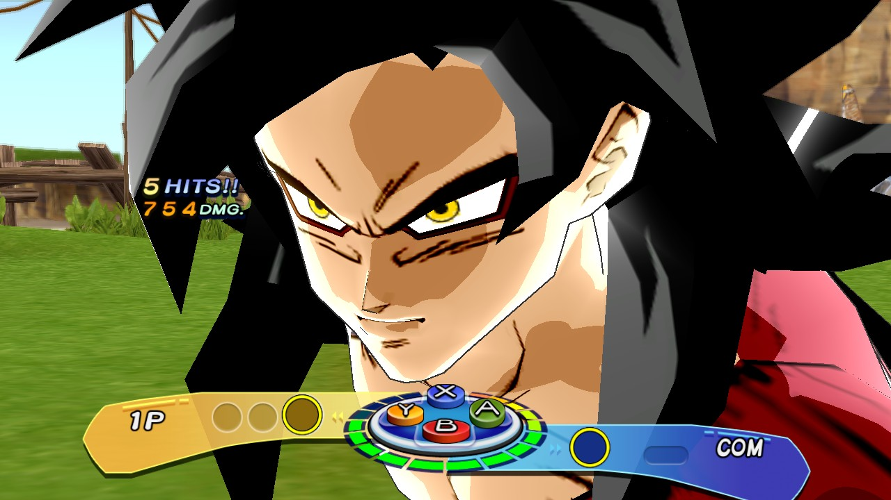
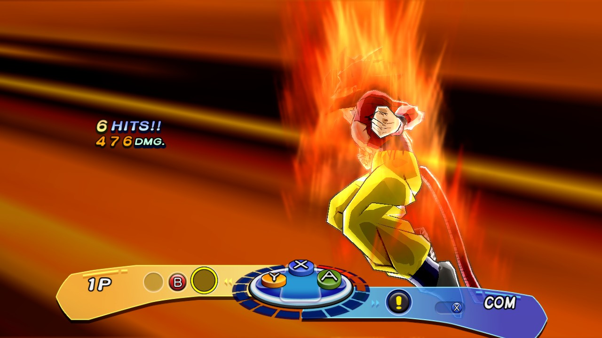
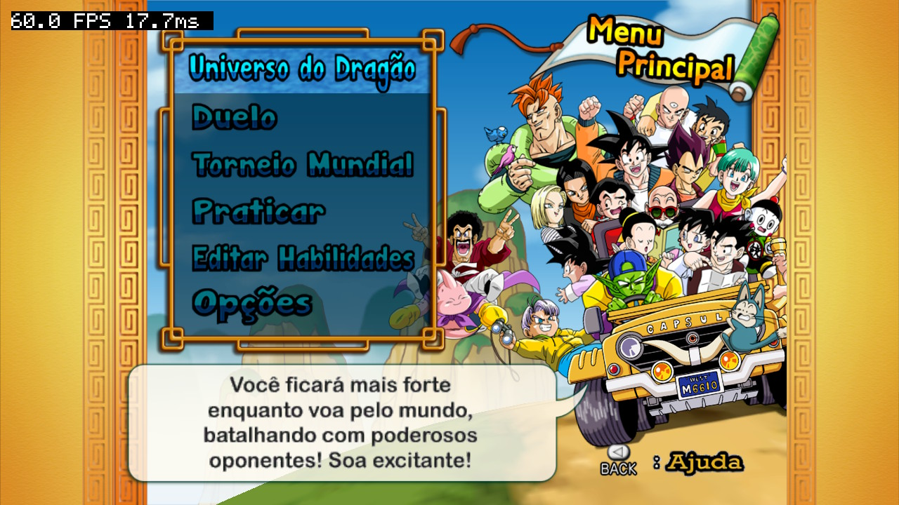

# Budokai3-nx — Dragon Ball Z: Budokai 3 HD para Nintendo Switch

Port homebrew não oficial de **Dragon Ball Z: Budokai 3 HD** para Nintendo Switch, baseado na edição Xbox 360 de *Dragon Ball Z: Budokai HD Collection*. O ReXGlue recompila o código PowerPC do jogo para ARM64. O port processa os comandos gráficos Xenos e renderiza com Deko3D.

[Release](https://github.com/ramonDias07/Budokai3-nx/releases/latest) · [Instalar](#instalar) · [Reportar bugs](#reportar-bugs) · [Compilar do código-fonte](#compilar-do-código-fonte) · [Capturas de gameplay](#capturas-de-gameplay) · [English overview](#english-overview)

Para jogar, baixe `B3deko-0.1.62.zip` na release e use o instalador de um arquivo (veja [Instalar](#instalar)). Ele monta a pasta do SD **no seu PC, a partir do seu próprio disco**: nenhum arquivo do jogo e nenhum shader derivado dele é distribuído aqui.

## Instalar

Só Windows 10/11 x64. Não precisa de Python, devkitPro nem compilador.

1. Baixe `B3deko-0.1.62.zip` na [release](https://github.com/ramonDias07/Budokai3-nx/releases/latest) e extraia.
2. Rode `B3deko-Installer.exe` e escolha o seu `.iso` **USA/Japan de Xbox 360** do *Dragon Ball Z Budokai HD Collection*.
3. Espere alguns minutos (cerca de 3 no PC de teste). São necessários uns 3 GB livres.
4. Copie a pasta `switch` criada em `sd\` (ao lado do instalador) para a raiz do cartão SD.
5. Abra o **B3deko** pelo Homebrew Menu em modo aplicativo.

Nada é enviado pela internet: tudo roda no seu PC. Os arquivos do jogo e os shaders são gerados a partir do seu disco e não são distribuídos. O Windows SmartScreen pode avisar porque o `.exe` não é assinado; o código está em [`tools/b3_installer.py`](tools/b3_installer.py) e pode ser refeito com [`tools/build_installer.ps1`](tools/build_installer.ps1).

**Ao atualizar:** preserve a pasta `budokai3/` (saves) e apague ou renomeie o `budokai3.toml` antigo para receber os novos padrões.

**Idioma:** o `budokai3.toml` da release já vem com a tradução PT-BR de TheRalf ligada. Para o inglês: menu rápido (`+` e `−` juntos) → **LANGUAGE** → **ENGLISH**, salve e reinicie o jogo.

## Estado do port

Destaques da **v0.1.62** (B3deko 0.1.57 a 0.1.62):

- **Especiais no GAME TIME:** o feixe e o fogo não somem mais na primeira vez que a cena carrega.
- **Revisão geral do código** (0.1.61): constantes dos shaders escritas em bloco, menos buscas de shader por desenho e relógio do jogo sem perda na conversão.
- **Áudio no GAME TIME:** emenda contínua perto da velocidade normal e atraso dos efeitos estável com o jogo mais lento.
- **Logs desligados por padrão:** o port só grava log no cartão com LOG TO FILE ligado no menu.

Continuam das versões anteriores: instalador de um clique para Windows (`install.bat`), tradução PT-BR de **TheRalf** ([detalhes](docs/traducao-ptbr.md)), legenda do menu rápido, 40 FPS nas lutas com a CPU de fábrica, áudio limpo, perfis DEFAULT, PERFORMANCE e NO OVERCLOCK, GPU boost oficial, conquistas com ícones e opções experimentais de dock.

| Área | Estado |
| --- | --- |
| Switch físico | Testadas no console até a 0.1.61, incluindo legenda, shaders de efeito, tradução PT-BR e os pacotes de desempenho. **Ainda não testadas no console:** a opção de log da 0.1.62, o cartão de detalhe da conquista e as opções de dock. Cada mudança da 0.1.61 tem uma opção própria para desligar no `budokai3.toml` ([lista](docs/release-v0.1.62.md)). **Defeito conhecido:** em alguns diálogos em quadrinhos depois de uma luta, o fundo fica congelado no último quadro da luta. |
| Desempenho | Luta a 40 FPS, modo portátil, CPU 1.020 MHz, boost GPU 460 MHz + RAM 1.600 MHz: **39,8 FPS** de média, GPU de **20,0 ms** por quadro. Faltas de áudio por 10 s com a CPU de fábrica: 54 a 260 (0.1.46 e 0.1.48) contra **1,3** na 0.1.49. [Medições e método](docs/performance.md) |

## Reportar bugs

Podem aparecer bugs. Para reportar:

1. Abra o menu rápido (`+` e `−` juntos) → **LOGS AND DIAGNOSTICS** → ligue **LOG TO FILE**.
2. Salve e reinicie o jogo.
3. Repita o problema. Se for defeito de imagem, aperte `L3 + R3` uma vez no quadro com defeito para gravar uma captura.
4. Abra uma [issue](https://github.com/ramonDias07/Budokai3-nx/issues) anexando `/switch/B3deko/logs/` (todos os arquivos), `/switch/B3deko/budokai3.toml`, a captura `b3_deko_diag` se você fez uma e, se o console travou ou fechou o jogo, os arquivos mais recentes de `/atmosphere/crash_reports/` e `/atmosphere/fatal_reports/`.
5. Depois, desligue **LOG TO FILE** de novo.

## Compilar do código-fonte

Alternativa ao instalador, para quem quer compilar tudo. Precisa de um dump `.iso` próprio do disco **USA/Japan para Xbox 360** (executável `DBZ3/yae3_xenon.xex`, SHA-256 `b40bba40cfd6c90cb269ebf5020818924f43109bcc86827a3cc37124c052a26b`). No Windows, instale o devkitPro, baixe **Source code** na release e dê dois cliques em `install.bat`; os passos à mão estão em [`docs/build.md`](docs/build.md). A saída fica em `out/sd/switch/B3deko/`.

## O que há no código

| Pasta | Conteúdo |
| --- | --- |
| `app/` | Manifesto, ajustes da recompilação USA/Japan, integração gráfica, sincronização de efeitos, menus e configuração padrão. |
| `patches/` | Alterações do SDK e do FFmpeg, aplicadas a versões fixas das dependências. |
| `tools/` | Extração do disco, reconstrução local dos shaders, preparação do SDK e empacotamento. |
| `docs/` | Guia de compilação, requisitos do dump, referências e medições no Switch. |

## No Switch

| Comando | Menu |
| --- | --- |
| `+` e `−` | Perfil, opções de cena e áudio. |
| `L + R + →` | Ajustes avançados. `L` e `R` trocam de aba. |
| `L + R + ←` | Conquistas. `A` abre o detalhe, `B` volta. |

Pressione `B` para fechar. Em **Ritmo normal** a trilha mantém seu próprio ritmo, enquanto vozes e efeitos acompanham o combate.

O **Dragon Rush** tem um layout ABXY próprio para o Switch. Com a configuração padrão, cada botão responde ao comando indicado no centro da tela.

## Capturas de gameplay

Capturas feitas no Switch com a build 0.1.38, mostrando o layout de Dragon Rush mantido na 0.1.40.

Menu principal com a tradução PT-BR opcional (tradução de TheRalf), capturado no Switch em 22/11/2026.

## Contribuições

Sugestões e pull requests de otimização são bem-vindos. Se você testar no console, conte o que funcionou e abra uma issue caso encontre um problema. Inclua a versão do port, a cena, o perfil gráfico, os clocks do console e, se possível, o trecho relevante do log. Para propor uma otimização, inclua medições antes e depois na mesma cena. [Issues](https://github.com/ramonDias07/Budokai3-nx/issues) · [Contribuidores](CONTRIBUTORS.md)

Se o projeto foi útil, deixe uma estrela no GitHub para acompanhar o repositório.

## Créditos e referências

### Jogo original

- **Dragon Ball Z: Budokai 3** foi desenvolvido pela **Dimps** e publicado pela **Bandai** no Japão e pela **Atari** na América do Norte e na Europa (PlayStation 2, 2004).
- **Dragon Ball Z: Budokai HD Collection** (Xbox 360 e PlayStation 3, 2012), a edição usada como base deste port, foi publicada pela **Namco Bandai Games**, hoje **Bandai Namco Entertainment**.
- **Dragon Ball** foi criado por **Akira Toriyama**. O mangá é publicado pela **Shueisha** e a série animada é produzida pela **Toei Animation**. ©BIRD STUDIO/SHUEISHA, TOEI ANIMATION.

O jogo, os personagens, a arte, a música, as vozes e o design pertencem a essas empresas e às equipes que os criaram. Se você gosta deste port, apoie as versões oficiais.

### Port e ferramentas

- **NovaPowers** pelo port original para PC e pela base de recompilação. [DBZ-Budokai-3-HD-Collection](https://github.com/novapowers0/DBZ-Budokai-3-HD-Collection)
- **Tom Clay, colaboradores do Xenia e nx-mod** pelo recompilador, runtime e suporte ao Switch. [ReXGlue](https://github.com/rexglue/rexglue-sdk) · [ReXGlue SDK NX](https://github.com/nx-mod/rexglue-sdk-nx)
- **StevensND** pelo trabalho no renderizador Deko/NFSMW e pelas rotinas reutilizadas de shaders, desenho e cache. [nfsmw-nx](https://github.com/StevensND/nfsmw-nx)
- **FurryLilManChild**, **ChanseyIsTheBest**, **masterspike52** e colaboradores pelos projetos LoS1-nx, SA2-nx e reNut. O extrator XDVDFS e a adaptação SPIR-V para GLSL/Deko vieram da árvore do LoS1-nx. [LoS1-nx](https://github.com/FurryLilManChild/LoS1-nx) · [sa2-nx](https://github.com/ChanseyIsTheBest/sa2-nx)
- **hedge-dev**, **devkitPro** e **Khronos** pelas ferramentas usadas na tradução de shaders. [XenosRecomp](https://github.com/hedge-dev/XenosRecomp) · [uam](https://github.com/devkitPro/uam) · [SPIRV-Cross](https://github.com/KhronosGroup/SPIRV-Cross)

### Tradução PT-BR

- **TheRalf** pela tradução de fãs em português do Brasil do *Dragon Ball Z: Budokai 3* de PS2 (patch v1.2). Ela foi feita à moda antiga, redesenhando à mão diálogos, menus, cápsulas e gráficos, e levou muito tempo. O mérito da tradução é todo dele. O port converte esse trabalho para a versão HD e o oferece pronto, como pacote anexado à release, para quem joga não precisar da ISO de PS2 nem do patch.

### Ferramentas embutidas no instalador

O `B3deko-Installer.exe` carrega **ReXGlue**, **XenosRecomp**, **DirectX Shader Compiler** (Microsoft), **SPIRV-Cross**, **uam**, o runtime do **LLVM-MinGW**, **Python** e **PyInstaller**. Nenhuma delas é afiliada a este projeto; os textos das licenças estão em [`licenses/`](licenses/).

Veja de onde veio cada parte e como outros ports tratam instalação e dados originais em [Referências](docs/referencias.md).

## English overview

**Budokai3-nx** is an unofficial Nintendo Switch homebrew port of **Dragon Ball Z: Budokai 3 HD** from the Xbox 360 collection. It uses ReXGlue for static recompilation and Deko3D for rendering. Version **0.1.62** builds on 0.1.56 (one-click Windows installer `install.bat`, the Brazilian Portuguese fan translation by **TheRalf**, all credit to him, quick-menu legend, 40 FPS fights at stock CPU clocks, clean audio, official GPU boost, achievements with in-game icons) and adds the fix for special-attack beams under GAME TIME, a code review pass with CPU savings, audio fixes for GAME TIME, and log files off by default (turn on LOG TO FILE in the quick menu for bug reports). Versions up to 0.1.61 were tested on a physical Switch; the 0.1.62 log switch was not yet. Known issue: in some story comic dialogues right after a fight, the background stays frozen on the last battle frame.

**Install (Windows 10/11 x64 only; no Python, devkitPro or compiler needed).** (1) Download `B3deko-0.1.62.zip` from the release and extract it. (2) Run `B3deko-Installer.exe` and pick your own **USA/Japan Xbox 360** `.iso` of Dragon Ball Z Budokai HD Collection. (3) Wait a few minutes (about 3 on the test PC; about 3 GB free needed). (4) Copy the `switch` folder it creates in `sd\` to the root of your SD card. (5) Launch B3deko from the Homebrew Menu in application mode. Nothing is uploaded: the game files and shaders are generated on your PC from your own disc and are not distributed. Windows SmartScreen may warn because the exe is unsigned (source: `tools/b3_installer.py`, rebuild with `tools/build_installer.ps1`). When updating, keep `budokai3/` (saves) and delete or rename the old `budokai3.toml`. The release `budokai3.toml` ships with the Brazilian Portuguese translation on; for English use quick menu → LANGUAGE → ENGLISH, save and restart.

**Reporting bugs.** Open the quick menu (`+` and `−` together) → LOGS AND DIAGNOSTICS → turn on LOG TO FILE → save and restart the game → repeat the problem (for picture problems also press `L3 + R3` once on the bad frame) → open an [issue](https://github.com/ramonDias07/Budokai3-nx/issues) attaching all of `/switch/B3deko/logs/`, `/switch/B3deko/budokai3.toml`, the `b3_deko_diag` capture if you made one, and, if the console froze or closed the game, the newest files from `/atmosphere/crash_reports/` and `/atmosphere/fatal_reports/`. Then turn LOG TO FILE off again.

**Build from source** (alternative): download **Source code**, install devkitPro and double-click `install.bat`, or follow the manual steps in the build guide. Hardware test reports and performance contributions are welcome in English or Portuguese. Bundled tools (ReXGlue, XenosRecomp, DirectX Shader Compiler, SPIRV-Cross, uam, LLVM-MinGW, Python, PyInstaller) keep their licences in [`licenses/`](licenses/). [Release](https://github.com/ramonDias07/Budokai3-nx/releases/latest) · [Build guide in Portuguese](docs/build.md) · [Gameplay screenshots](#capturas-de-gameplay) · [Issues](https://github.com/ramonDias07/Budokai3-nx/issues)

**Original game and legal notice.** *Dragon Ball Z: Budokai 3* was developed by **Dimps** and published by **Bandai** and **Atari**. *Dragon Ball Z: Budokai HD Collection* was published by **Namco Bandai Games**, now **Bandai Namco Entertainment**. *Dragon Ball* was created by **Akira Toriyama**. ©BIRD STUDIO/SHUEISHA, TOEI ANIMATION. This is a non-commercial fan project. It is **not affiliated with or endorsed by** Bandai Namco, Dimps, Atari, Shueisha, Toei Animation, Bird Studio, Microsoft or Nintendo. This repository contains no game code or assets. You must own the original disc and make your own dump. Rights holders with a concern can open an issue, and the material will be reviewed or removed promptly.

## Aviso legal

Este é um projeto de fãs, não oficial e sem fins lucrativos. **Não tem afiliação, patrocínio nem aprovação** da Bandai Namco Entertainment, Dimps, Atari, Shueisha, Toei Animation, Bird Studio, Microsoft ou Nintendo.

- *Dragon Ball*, *Dragon Ball Z* e *Budokai* são marcas e obras protegidas dos respectivos titulares. ©BIRD STUDIO/SHUEISHA, TOEI ANIMATION. O jogo é © Bandai Namco Entertainment Inc.
- *Xbox 360* é marca da Microsoft Corporation e *Nintendo Switch* é marca da Nintendo. Os nomes aparecem aqui só para indicar compatibilidade.
- Este repositório **não distribui** o jogo, seus executáveis, arquivos de dados, áudio, vídeo, código recompilado nem chaves. A única exceção é a tradução de fãs de TheRalf, anexada à release como pacote `ptbr.b3tr`: ela só contém as telas traduzidas, funciona apenas sobre os arquivos do disco 360 de quem joga e segue a forma como traduções de fãs costumam ser distribuídas. Para compilar, é preciso um disco original adquirido legalmente e um dump feito pela própria pessoa. Não peça nem compartilhe ISOs ou NROs que contenham dados do jogo.
- As capturas em `docs/screenshots/` servem só para documentar o funcionamento do port. As imagens do jogo continuam pertencendo aos titulares.
- Titulares de direitos com alguma objeção podem abrir uma [issue](https://github.com/ramonDias07/Budokai3-nx/issues). O material será revisto ou removido prontamente.

## Licenças

O código deste port segue a GPL-3.0. Os componentes de terceiros mantêm suas licenças em [`licenses/`](licenses/) e nas próprias árvores. A GPL-3.0 vale apenas para o código deste repositório e não cobre o jogo original nem os dados extraídos dele. O dump, os executáveis do jogo, a recompilação gerada, os caches derivados, os arquivos de arte extraídos, os saves e os NROs gerados ficam no computador de quem compila.
